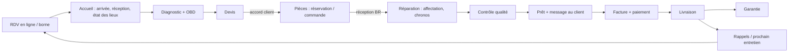

# PROPOSITION V16 — organiser GaragePro dans l'ordre du travail du garage (phase B)

**Rien de ceci n'est encore fait.** C'est une proposition à valider point par point (« OK pour 1, 2, 4 », etc.).
Aucune fonction n'est retirée : ce qui bouge garde son ancienne adresse (redirection), ce qui est désactivé est seulement caché.
Les problèmes de `docs/AUDIT-V16.md` (5 bloquants, 22 importants) sont corrigés en phase C de toute façon, chacun avec un test.

---

## Le schéma d'ensemble

```
                         ┌───────────────────────────────────────────────┐
  Client ──► RDV en ligne│ 1. ACCUEIL / RÉCEPTION                         │
  Borne / ticket ───────►│ agenda du jour · arrivées · RDV · réception    │
                         │ état des lieux · devis · livraison · caisse    │
                         └───────────────┬───────────────────────────────┘
                                         │ ordre de réparation
                                         ▼
 ┌──────────────────────┐   pièce   ┌────────────────────────────────────┐
 │ 3. PIÈCES / ACHATS   │◄─────────►│ 2. ATELIER                          │
 │ stock · réservations │ manquante │ ordres par étape (kanban) · atelier │
 │ fournisseurs · BC ·  │  / reçue  │ mobile · contrôle qualité · OBD ·   │
 │ réceptions · factures│           │ pièces manquantes · [ponts V13]     │
 └──────────┬───────────┘           └───────────────┬────────────────────┘
            │ factures fournisseurs                 │ « Prêt »
            ▼                                       ▼
 ┌──────────────────────┐  facture  ┌────────────────────────────────────┐
 │ 5. ARGENT            │◄──────────│ 4. CLIENTS                          │
 │ factures · paiements │  paiement │ clients/véhicules · carnet ·        │
 │ caisse · dépenses ·  │           │ entreprises · réclamations/avis ·   │
 │ trésorerie · garanties│          │ rappels · [compte SMS, relance V13] │
 │ rentabilité          │           └────────────────────────────────────┘
 └──────────────────────┘
 ┌──────────────────────┐ ┌──────────────┐ ┌────────────────────────────────┐
 │ 6. ÉQUIPE            │ │ 7. VENTES    │ │ 8. DIRECTION                    │
 │ pointage · congés ·  │ │ showroom ·   │ │ tableau de bord · rapports ·    │
 │ calendrier · compé-  │ │ messages     │ │ paramètres · journal · aide ·   │
 │ tences · contrats ·  │ │ acheteurs    │ │ sauvegardes · modules           │
 │ attestations         │ └──────────────┘ └────────────────────────────────┘
 └──────────────────────┘
```



---

## 1. Navigation « parcours atelier » par espace

**Aujourd'hui** : 6 entrées en haut (argent surtout), 7 à gauche (atelier), 5 dans le menu du compte, 18 dans « Plus » (vue admin). Une même notion est rangée selon l'ordre où elle a été ajoutée (V5 → V15), pas selon le travail. Exemples : *Accueil (file d'attente)* est dans « Plus › Espace client » ; *Garanties* aussi, alors que c'est de l'argent ; *Contrats* est dans le menu du compte.

**Proposé** : 8 espaces, dans l'ordre du travail. Le rail de gauche montre les espaces ; un clic ouvre la liste des pages de l'espace (pas de « Plus » fourre-tout).

| Espace | Pages (existantes, simplement rangées) | Rôles qui le voient |
|---|---|---|
| **Accueil / Réception** | Aujourd'hui (agenda du jour + arrivées), File d'attente, Rendez-vous, Nouvel ordre / réception + état des lieux, Devis à envoyer, Prêts à livrer, Encaisser | A, M, R |
| **Atelier** | Ordres par étape (kanban), Atelier mobile, Contrôle qualité à faire, OBD, Pièces manquantes · *[V13 : planning des ponts]* | A, M, R, Méca |
| **Pièces / Achats** | Stock, Réservations, Fournisseurs, Bons de commande, Réceptions, Factures fournisseurs | A, M, Mag (Compta : factures fournisseurs) |
| **Clients** | Clients et véhicules, Carnet du véhicule, Entreprises, Réclamations & avis, Rappels et prévisions d'entretien · *[V13 : compte client SMS, relances, contrats d'entretien, livraison, dépannage]* | A, M, R (Méca : lecture) |
| **Argent** | Factures, Paiements, Caisse, Dépenses, Trésorerie, Garanties & remboursements, Rentabilité | A, M, Compta (R : factures et paiements) |
| **Équipe** | Pointage, Congés, Calendrier, Compétences, Contrats, Attestations | tous pour « moi » ; A, M, RH pour l'équipe |
| **Ventes** | Showroom, Messages acheteurs | A, V, SR (M, R : lecture) |
| **Direction** | Tableau de bord, Rapports, Paramètres, Modules, Journal, Sauvegardes, Aide | A (M : tableau de bord) |

- **Chaque rôle ne voit que ses espaces** (les permissions existantes décident ; l'accès sur mesure continue de marcher).
- **Écran d'accueil de chaque rôle = « Ce que je dois faire maintenant »** : « À traiter » fusionné avec le haut du tableau de bord, trié par urgence, et **3 boutons principaux maximum** en haut :
  - Réception : *Accueillir un client* · *Nouvel ordre* · *Encaisser*
  - Mécanicien : *Mes ordres* · *Démarrer / arrêter mon chrono* · *Signaler une pièce manquante*
  - Magasinier : *Réceptionner* · *Pièces manquantes* · *Commander*
  - Responsable : *Ordres en retard* · *Contrôles à valider* · *Demandes à approuver*
  - Comptable : *Factures en retard* · *Payer un fournisseur* · *Trésorerie*
  - RH : *Congés à décider* · *Pointages à corriger* · *Attestation*
  - Vendeur : *Mes annonces* · *Messages* · *Nouvelle annonce*
  - Admin : *Tableau de bord* · *À traiter* · *Paramètres*
- Les anciennes adresses (`/garage/suivi`, `/garage/appointments`…) restent valables (redirections).

## 2. Un seul endroit par notion

| Notion | Aujourd'hui | Proposé |
|---|---|---|
| Rappels / alertes | 7 endroits (doublon D1) | **Une liste « Rappels »** (Clients) pour ce qui part chez le client ; **« À traiter »** pour ce que l'équipe doit faire ; le tableau de bord n'affiche que des compteurs qui ouvrent ces deux listes |
| Entretien | plans V7.6 + agenda V12 (D2) | **Agenda V12 seul** ; les plans V7.6 existants sont convertis en prévisions (rien n'est perdu) |
| Messages | 3 notions (D4) | **Une messagerie** avec un filtre : client d'atelier / acheteur showroom / message d'entretien |
| Calendrier | 3 pages (D3) | **Un calendrier** avec des calques : RDV, congés, livraisons promises, *[V13 : ponts]* ; l'agenda d'entretien devient « Prévisions » dans Clients |
| Journal | une page + chronologies | inchangé ; libellés traduits (n° 36) |
| Document | devis, facture, BC, prise en charge, attestation, contrat : rendus et boutons différents | **Un modèle de document** : même en-tête, même pied, mêmes boutons **Imprimer · PDF · Envoyer (SMS / e-mail / WhatsApp) · Partager le lien** |
| Personnel | Paramètres + Équipe (D6) | **Équipe seulement** (création des comptes comprise) |
| Temps de travail | pointage + chronos (D7) | une seule définition de « présent » ; le chrono propose de pointer si l'employé n'a pas pointé |

## 3. Fiche véhicule = centre de tout

Aujourd'hui **il n'y a pas de page véhicule** : la « fiche » est un morceau de la fiche client, l'entretien, l'OBD et le QR sont des pages séparées.

Proposé : `/garage/vehicules/[id]` avec en haut la plaque, le client, le kilométrage, l'ordre en cours (bouton direct), puis des onglets :

**Chronologie** (tout, du plus récent au plus ancien, une seule liste) · Ordres · Factures · Photos · OBD · Contrôles qualité · Garanties · Prévisions d'entretien · Contrats · États des lieux · QR.

La recherche par plaque mène ici. Les anciennes pages (`/entretien`, `/obd`, `/qr`) deviennent des onglets (adresses gardées).

## 4. Fiche ordre = étapes de gauche à droite

Aujourd'hui : **112 boutons et champs** visibles d'un coup, page de 5 880 px (PC) / 6 674 px (téléphone) (n° 37).

Proposé :

```
[ Réception ]─[ Diagnostic ]─[ Devis ]─[ Pièces ]─[ Réparation ]─[ Qualité ]─[ Prêt ]─[ Livré ]
                                          ▲ étape en cours
┌──────────────────────────────────────────────────────────────────────────────┐
│ Prochaine action :  [ Valider le contrôle qualité ]                           │
│ Bloqué : « Prêt » impossible — contrôle qualité non validé par un responsable │
├──────────────────────────────────────────────────────────────────────────────┤
│ Blocs utiles à l'étape (ouverts)    │ Autres blocs (repliés, un clic)        │
└──────────────────────────────────────────────────────────────────────────────┘
```

| Étape | Blocs ouverts | Prochain bouton | Blocages expliqués |
|---|---|---|---|
| Réception | état des lieux, km, plainte, photos d'arrivée | *Passer au diagnostic* | km ou état des lieux manquant |
| Diagnostic | diagnostic, OBD, suggestions d'entretien | *Préparer le devis* | — |
| Devis | lignes, forfaits, total, envoyer le devis | *Envoyer au client* / *Accord reçu* | aucune ligne |
| Pièces | pièces manquantes, réservations, commandes en cours | *Toutes les pièces sont là* | « Kit distribution : commandé BC2026-0001, attendu le … » |
| Réparation | affectation (compétences), chronos, pièces consommées | *Terminer → contrôle qualité* | — |
| Qualité | checklist (bouton « tout est conforme »), validation | *Prêt* | « Prêt bloqué : contrôle qualité non validé » |
| Prêt | message au client, facture, encaissement | *Facturer et encaisser* | — |
| Livré | garantie créée, rappel programmé, avis client | — | « Livraison bloquée : facture non payée » (sauf dérogation tracée) |

Le mécanicien voit la même fiche **sans montants** (n° 10).

## 5. Simplifier les gestes quotidiens

**Recherche globale partout** (barre du haut, raccourci `/`) : plaque, client, téléphone, n° d'ordre, n° de facture, référence de pièce → résultat direct (aujourd'hui la recherche du haut ne fait que les plaques).

**Raccourcis pour les 10 gestes du jour** (sur l'écran d'accueil du rôle et au clavier) : accueillir un client · nouvel ordre · étape suivante · démarrer / arrêter chrono · signaler une pièce manquante · valider le contrôle qualité · facturer et encaisser · livrer · réceptionner une commande · pointer.

**Aide courte sur chaque page** : un bouton « ? » qui ouvre 3 à 5 lignes (à quoi sert la page, le geste principal, qui peut le faire). Aujourd'hui l'aide est une seule page de 19 lignes.

**Clics mesurés pour 5 tâches fréquentes** (avant = mesuré dans le navigateur sur la base de démo, captures `docs/media/v16/avant/tache-*.png` ; après = estimation) :

| Tâche | Rôle | Avant (mesuré) | Après (estimé) | Ce qui change |
|---|---|---|---|---|
| T1 Accueillir le client d'un RDV du jour | Réception | **2 clics** | **1 clic** | bouton *Accueillir* directement sur l'écran « Aujourd'hui » |
| T2 Ouvrir un ordre pour un client connu | Réception | **3 clics + 3 saisies** (plaque, plainte, km) | **2 clics + 2 saisies** | plaque tapée dans la recherche globale → *Nouvel ordre* depuis le résultat, km pré-rempli et modifiable |
| T3 Mener un ordre « en réparation » jusqu'à « Prêt » (contrôle qualité compris) | Responsable | **12 clics** (6 cases + enregistrer + valider + 3 étapes) | **5 clics** | *Tout est conforme* (1 clic au lieu de 7), *Enregistrer et valider* d'un coup pour le responsable, Lavage facultatif |
| T4 Facturer, encaisser le total, livrer | Admin / réception | **6 clics** | **3 clics** | *Facturer et encaisser* depuis la liste « Prêts » (montant pré-rempli), puis *Livrer* sur la même fenêtre |
| T5 Commande fournisseur : approuver puis réceptionner | Admin + magasinier | **10 clics** (5 + 5 ; dont 1 filtre atteint par adresse dans le test) | **4 clics** | *Approuver* depuis « À traiter » ; *Réceptionner* depuis l'écran du magasinier ; réception pré-remplie par le bon |
| **Total** | | **33 clics** | **15 clics** | |

## 6. Modules « avancés » activables

Nouvelle page **Paramètres › Modules** (admin) : un interrupteur par module. **Désactivé = caché** (menus, blocs, « À traiter », portail public) ; **jamais supprimé** : les données restent, on peut réactiver à tout moment.

Modules proposés : OBD · Showroom + messagerie acheteurs · Contrats · Trésorerie prévisionnelle · Accueil / file d'attente (borne, écran) · Compétences · Agenda d'entretien prévisionnel · Portail entreprise · Garanties fournisseur · Rentabilité · Borne de pointage · RDV en ligne · Assistant IA.
Toujours actifs (cœur) : ordres, clients / véhicules, stock, factures / paiements, équipe (pointage, congés), paramètres.

Hors ligne : chaque module qui a besoin d'internet (SMS, e-mail, IA, RDV en ligne, portails, showroom public) affiche un petit bandeau « nécessite internet — sera envoyé au retour de la connexion » au lieu d'échouer en silence.

## 7. Idées d'amélioration repérées pendant l'audit (à choisir, rien n'est fait)

| # | Idée | Bénéfice | Effort | Risque |
|---|---|---|---|---|
| I1 | **Anti-double-clic côté serveur** (jeton unique) sur encaisser, réceptionner, accueillir un RDV, accord du devis | supprime les doublons n° 6, 7, 15, 19 | faible | faible |
| I2 | **Livraison protégée** : pas de « Livré » sans facture payée, sauf dérogation d'un responsable avec motif (tracée, visible dans « À traiter ») | plus de voiture partie sans paiement (n° 2) | faible | moyen (habitudes à changer) |
| I3 | **Pièce reçue → ordre débloqué** : à la réception, la pièce manquante passe « reçue », est réservée pour l'ordre et le mécanicien est prévenu | supprime le n° 13, moins d'appels « elle est arrivée ? » | moyen | faible |
| I4 | **Paiement daté + annulation / avoir** par un responsable, avec motif | trésorerie juste (n° 26), erreurs de saisie corrigeables sans toucher la base | moyen | moyen (règles comptables à valider) |
| I5 | **Stock « réservé au devis, consommé à l'accord »** | stock réel exact, plus de pièces bloquées par des devis refusés | moyen | moyen |
| I6 | **Un seul système d'entretien** (plans V7.6 convertis en prévisions V12) | une seule liste de rappels, pas de double SMS | moyen | faible (conversion testée sur copie) |
| I7 | **Écran « Mon travail » du mécanicien** au téléphone : mes ordres, chrono, contrôle qualité, pièce manquante — sans montants | moins de clics à l'atelier, confidentialité (n° 10) | moyen | faible |
| I8 | **File d'envoi unique** pour tous les messages client (prêt, RDV, rappel, devis) : historique, nouvelle tentative au retour d'internet, langue du client | plus de message perdu (n° 9), hub fiable | moyen | faible |
| I9 | **Contrôle de cohérence quotidien** (factures = paiements = trésorerie, stock négatif, ordres livrés non facturés) affiché dans « À traiter » de l'admin | les écarts sont vus le jour même | faible | faible |
| I10 | **Vérification du hub au démarrage** (sequences pair / impair, tables sans trigger, version de schéma) avec message clair | évite la divergence n° 38 | faible | faible |

*(Le parrainage n'est pas proposé, conformément à la décision du propriétaire.)*

## Où viendra la V13 (pas comptée comme manque)

- **Planning des ponts** → espace *Atelier* (et calque du calendrier unique).
- **Compte client par SMS, relances** → espace *Clients* (s'appuie sur la file d'envoi unique, idée I8).
- **Livraison à domicile, dépannage** → espace *Accueil / Réception* (étape « Livré » de la fiche ordre).
- **Contrats d'entretien** → espace *Clients* (réutilise le module Contrats existant, catégorie « flotte », et les prévisions V12).

---

**Réponse attendue du propriétaire** : la liste des points acceptés (1 à 7) et des idées retenues (I1 à I10). Proposition de l'ordre de la phase C : d'abord les 5 bloquants et les 22 importants (avec leurs tests), puis les points acceptés, un commit par étape.
